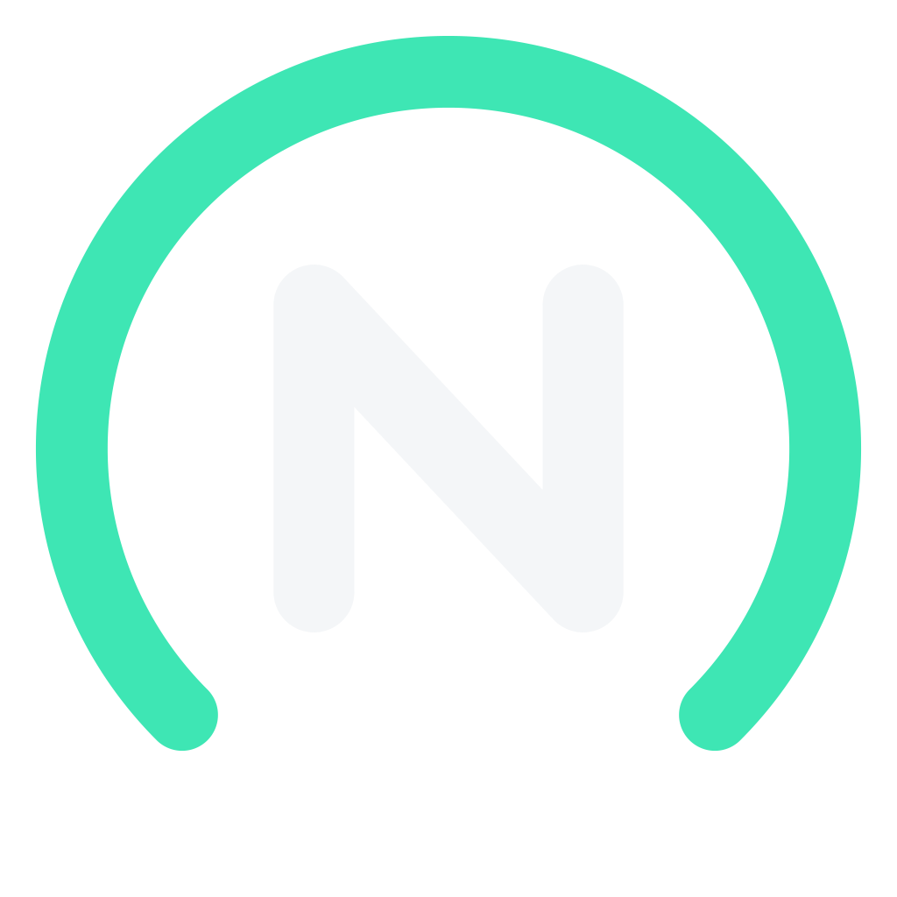

  

<h1 align="center">NishPilot</h1>

## What is NishPilot?
NishPilot is a personal fork of [sunnypilot](https://github.com/sunnypilot/sunnypilot), which is itself a fork of
[openpilot by comma.ai](https://github.com/commaai/openpilot), an open source driver assistance system.

It is built for one car and one device: a 2023 Hyundai Ioniq 5 on a comma 4. On top of sunnypilot it adds
[Jetlink](https://github.com/zoompilot/jetlink) support, so the comma can run openpilot's larger driving models on a
computer connected over USB, falling back to the small on-device model if the link drops or lags.

Everything else (car support, safety, steering, longitudinal control, MADS) is sunnypilot's, unchanged.

## Built on
NishPilot exists because of the work of others:

* **[openpilot](https://github.com/commaai/openpilot)** by [comma.ai](https://comma.ai): the driver assistance system,
  the driving models, and the device.
* **[sunnypilot](https://github.com/sunnypilot/sunnypilot)** by Jason Wen and the sunnypilot contributors: the fork
  NishPilot is based on, including its car support, MADS, the model manager and sunnylink.
* **[Jetlink](https://github.com/zoompilot/jetlink)** by Zeph Leggett: the comma-side link and the openpilot adapter,
  ported from [zoompilot](https://github.com/zoompilot/zoompilot).

If you find these features useful, please support the upstream projects; for sunnypilot, see
[sponsoring sunnypilot](https://github.com/sponsors/sunnyhaibin) and its [community forum](https://community.sunnypilot.ai/).

## Safety
**THIS IS ALPHA QUALITY SOFTWARE FOR RESEARCH PURPOSES ONLY.** You are responsible for complying with local laws and
regulations, and for staying attentive and ready to take over at all times. The panda safety code and every car's
control code are sunnypilot's, unmodified.

## 📊 User Data

By default, NishPilot uploads the driving data to comma servers, as openpilot and sunnypilot do. You can also access your
data through [comma connect](https://connect.comma.ai/).

NishPilot is open source software. The user is free to disable data collection if they wish to do so.

NishPilot logs the road-facing camera, CAN, GPS, IMU, magnetometer, thermal sensors, crashes, and operating system logs.
The driver-facing camera and microphone are only logged if you explicitly opt-in in settings.

By using this software, you understand that use of this software or its related services will generate certain types of user data, which may be logged and stored at the sole discretion of comma. By accepting this agreement, you grant an irrevocable, perpetual, worldwide right to comma for the use of this data.

## Licensing

NishPilot is released under the [MIT License](LICENSE). It is derived from sunnypilot, which is released under the MIT
License and includes original work as well as significant portions of code derived from
[openpilot by comma.ai](https://github.com/commaai/openpilot), which is also released under the MIT license with
additional disclaimers. Jetlink is released under the MIT License (see `jetlink_repo/LICENSE`). Every file's copyright
header is kept as it was.

The original openpilot license notice, including comma.ai’s indemnification and alpha software disclaimer, is reproduced below as required:

> openpilot is released under the MIT license. Some parts of the software are released under other licenses as specified.
>
> Any user of this software shall indemnify and hold harmless Comma.ai, Inc. and its directors, officers, employees, agents, stockholders, affiliates, subcontractors and customers from and against all allegations, claims, actions, suits, demands, damages, liabilities, obligations, losses, settlements, judgments, costs and expenses (including without limitation attorneys’ fees and costs) which arise out of, relate to or result from any use of this software by user.
>
> **THIS IS ALPHA QUALITY SOFTWARE FOR RESEARCH PURPOSES ONLY. THIS IS NOT A PRODUCT.
> YOU ARE RESPONSIBLE FOR COMPLYING WITH LOCAL LAWS AND REGULATIONS.
> NO WARRANTY EXPRESSED OR IMPLIED.**

For full license terms, please see the [`LICENSE`](LICENSE) file.
